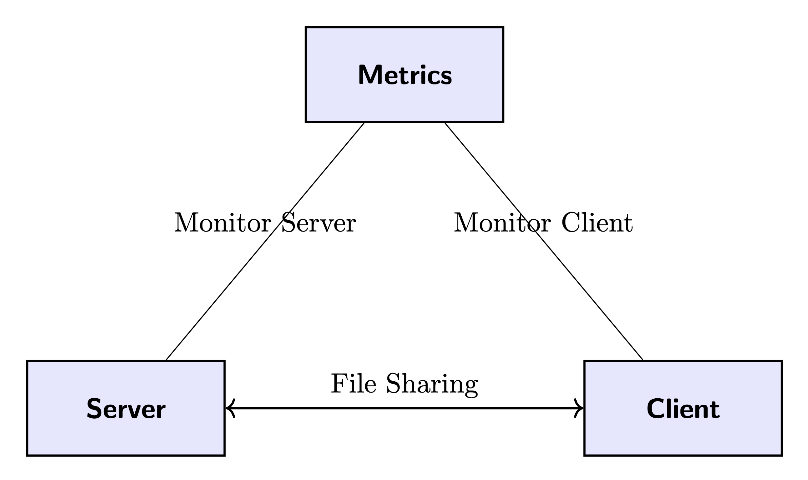

# Computer Networks Server-Client Architecture - Group 7: Nia Crusan, Dani Rojas Gonzalez, Hosevana Lindsey

This project will implement a client-server architecure for a distributed file sharing system.
The system will be under certain core constraints; employing multi-threading for quick access
and support for a myriad of file types.


## Objectives
- Have a client & server application that communicate to each other.
- Allow users to upload a variety of files & have said files categorized.
- Clients will be able to interact with the system via commands; Connect, Upload, etc.
- The system will gather metrics throughout its runtime that can be later analyzed.
- The client & server will have approriate forms of error handling for smooth operation.
- Development of the system will be monitored via Github Remote VCS.
- ### Server updates:
   - 2026-11-15 added barebones test code.
   - 2026-11-24 undid everything and restart. build things from ground up, starting with connecting server.py (uploaded to google cloud vm) and client.py (running on a personal computer)
   - 2026-11-24 server creates a storage directory server.py
   - 2026-11-25 client can upload files to the storage directory via server.py
   - 2026-11-25 client can download files from the storage directory
   - 2026-11-25 client can add and delete subfolder directories
   - 2026-11-25 client can delete files and change their current directory in server storage
   - 2026-11-26 server sanitizes file names
   - 2026-11-26 add a password protection service

## Requirements
- Text files must be under 25 MB
- Audio files must be under 0.5 GB
- Video files must be under 2 GB

## Authentication and TLS setup

The server requires one configured username/password and a TLS certificate.
Passwords are entered on the client with a hidden prompt; the server stores
only a PBKDF2-HMAC-SHA256 hash and salt. Each client operation authenticates
over TLS. Do not commit credentials, password hashes, TLS private keys, or
environment files to Git.

On the server, generate a password hash (the script prompts twice and prints
the salt and hash, not the password):

```bash
python3 server.py --create-password-hash
```

Configure these environment variables before starting the server:

```bash
export FILESERVER_USERNAME='your-user'
export FILESERVER_PASSWORD_SALT='salt-hex-from-command'
export FILESERVER_PASSWORD_HASH='hash-hex-from-command'
export FILESERVER_TLS_CERT='/path/to/fullchain.pem'
export FILESERVER_TLS_KEY='/path/to/private-key.pem'
```

Use a certificate whose Subject Alternative Name (SAN) matches the hostname
or IP address clients connect to. A certificate from a publicly trusted CA
needs no extra client CA setting. If using a private CA, securely distribute
its CA certificate to each client. Keep the private key and password hash
readable only by the server account; for a deployed VM, use a protected
environment file rather than putting secrets in source code or a committed
configuration file.

## To run

```bash
python3 server.py
```

The server will refuse to start if the required authentication or TLS
environment variables are missing.

The server stores files in `/mnt/disks/file-storage` by default. Set
`FILE_STORAGE_DIR` to use another directory:

```bash
FILE_STORAGE_DIR=/directory/path python3 server.py
```
Set the full directory to work properly, not just the directory the command is run in.

Enter `DIR` in the client to list server files. Use `UPLOAD <local-file-path>`
to send a file; only the local file's name is stored on the server. If a file
with that name already exists, the client asks before overwriting it. Use
`DOWNLOAD <filename>` to save a server file to the client's Downloads folder;
the client asks before replacing an existing local file. Use `DELETE <filename>`
to remove a file from the current server directory; the client confirms first.

Use `CD <directory>` to move through server folders, `CD ..` to move up, and
`CD /` to return to the storage root. `DIR`, `UPLOAD`, `DOWNLOAD`, and `DELETE`
operate on the current server directory. The current directory is tracked by
the client and resets to the root when the client restarts. Manage folders
relative to the current directory with `SUBFOLDER CREATE <path>` and
`SUBFOLDER DELETE <path>` (for example, `SUBFOLDER CREATE reports/weekly`).
Folder deletion only removes empty folders; remove their contents first.

The client connects to the server on TCP port `3300` by default. Before
starting it, configure the hostname or IP address and, when needed, the private
CA certificate (PowerShell example):

```powershell
$env:FILESERVER_HOST = "fileserver.example.com"
$env:FILESERVER_TLS_NAME = "fileserver.example.com"
# Only needed when the server certificate uses a private CA:
$env:FILESERVER_CA_CERT = "C:\certs\server-ca.pem"
python client.py
```

`FILESERVER_TLS_NAME` must match a name in the server certificate's SAN; it
defaults to `FILESERVER_HOST`. `FILESERVER_PORT` can override the default port.
The client prompts for the configured username and password when it starts.

The server connects on TCP port `3300` by default. Open that port in the VM's
firewall only to the client networks that need access.
## Process Overview

