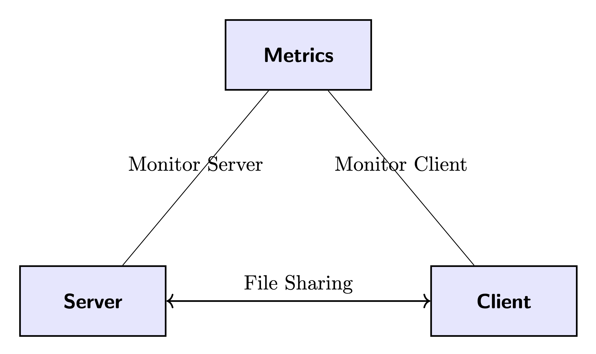

# Computer Networks Server-Client Architecture - Group 7

This project will implement a client-server architecure for a distributed file sharing system.
The system will be under certain core constraints; employing multi-threading for quick access
and support for a myriad of file types.

## Objectives
- Have a client & server application that communicate to each other.
- Allow users to upload a variety of files & have said files categorized.
- Clients will be able to interact with the system via commands; Connect, Upload, etc.
- The system will gather metrics throughout its runtime that can be later analyzed.
- The client & server will have approriate forms of error handling for smooth operation.
- Development of the system will be monitored via Github Remote VCS.

## Requirements
- Text files must be under 25 MB
- Audio files must be under 0.5 GB
- Video files must be under 2 GB

## Process Overview
